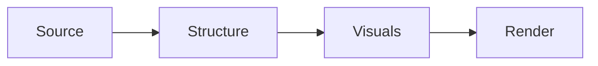

# {{DECK_TITLE}}

> This is the structured outline for the deck. It is both a deliverable and the
> source of truth for rendering. Edit this file and re-run the render stage to
> regenerate the HTML.

## Metadata

- **Title:** {{DECK_TITLE}}
- **Subtitle:** {{DECK_SUBTITLE}}
- **Source:** {{SOURCE_DESCRIPTION}} <!-- e.g. "YouTube talk 'Designing Data-Intensive Apps' (42 min)" -->
- **Audience:** {{AUDIENCE}} <!-- e.g. "Mid-level backend engineers" -->
- **Deck type:** {{TYPE}} <!-- transcript | report | guide | essay | meeting -->
- **Target length:** {{SLIDE_COUNT}} slides
- **Theme:** clean-minimal-light (default)

## Narrative arc

One paragraph, written by Claude during the structure stage, describing the
arc of the deck in prose. This is the story the slides tell. Read this
paragraph and ask: does the deck actually deliver this arc? If not, either
the arc needs to change or the sections do.

Example: "We open by showing why database indexing is often misunderstood. We
move through four common mistakes, illustrating each with a small example.
We close with a checklist the audience can apply to their own systems today."

---

## Section 1 — {{SECTION_TITLE}}

**Summary.** One or two sentences describing what this section covers and why
it belongs here.

**Slides:** {{N}}

### Slide 1.1 — {{SLIDE_TITLE}}

- Key point one
- Key point two
- Key point three

**Visual:** Concrete description of the image/diagram this slide should show,
or `none` if the slide is text-only.

**Speaker notes:** What the presenter says around this slide. For transcript-
sourced decks, preserve the original voice here; for report-sourced decks,
write fresh notes that expand on the bullets.

### Slide 1.2 — {{SLIDE_TITLE}}

- Key point one
- Key point two

**Visual:** none

**Speaker notes:** ...

### Slide 1.3 — {{SLIDE_TITLE}}

> A quote or pulled statement that anchors this slide.

**Visual:** Description of a supporting image that reinforces the quote.

**Speaker notes:** ...

---

## Section 2 — {{SECTION_TITLE}}

**Summary.** ...

**Slides:** {{N}}

### Slide 2.1 — {{SLIDE_TITLE}}

- ...

**Visual:** ...

**Speaker notes:** ...

<!-- Continue sections as needed. -->

---

## Closing

### Slide N.1 — Takeaways

- The most important thing to remember
- The surprising or counterintuitive thing
- The one concrete next step

**Visual:** none

**Speaker notes:** Land the plane. Recap the throughline.

### Slide N.2 — Questions / Further reading

- Optional resources
- Contact or follow-up path

**Visual:** none

**Speaker notes:** Open it up for discussion.

---

## Visual inventory

A flat list of every visual in the deck, useful for sanity-checking density
and for batch-generating or sourcing images later. Claude populates this
during the visual-description stage.

| Slide | Description |
|-------|-------------|
| 1.1   | ... |
| 2.3   | ... |
| ...   | ... |

## Mermaid diagrams

If the deck uses mermaid diagrams, list them here with their code blocks so
they can be edited in one place. Claude populates this during the visual
stage.

### Slide 3.2 — Pipeline flow

